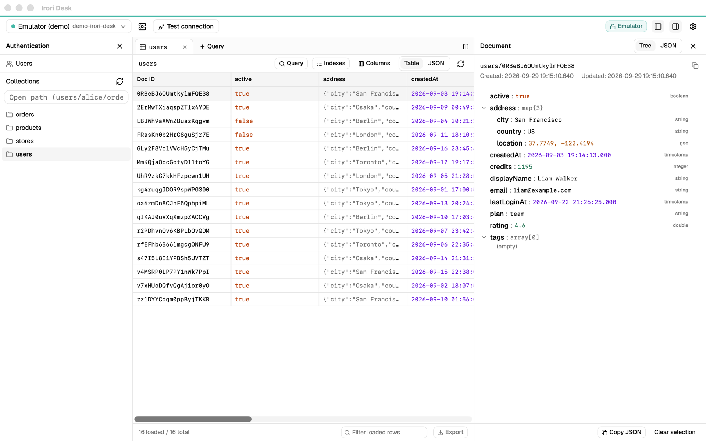
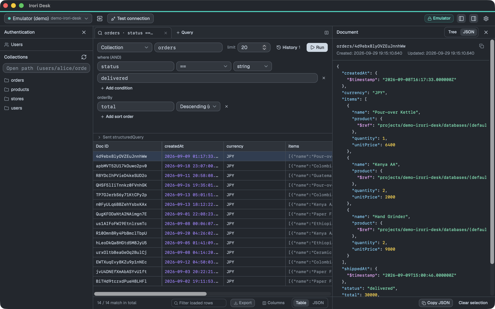
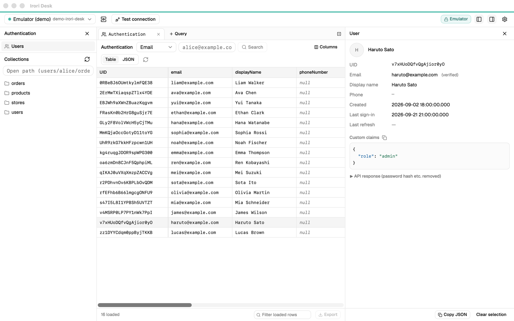
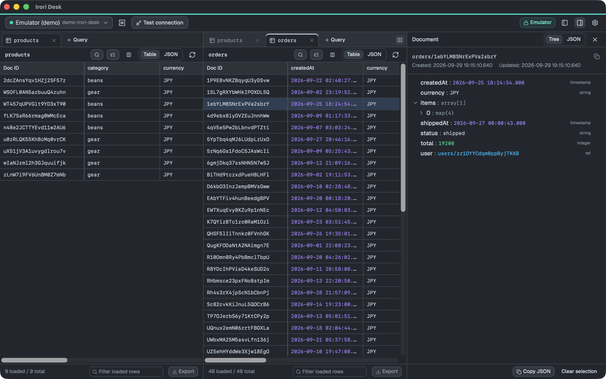

# Irori Desk

[English](../README.md) | 日本語

Cloud Firestore と Firebase Authentication を閲覧・クエリするためのデスクトップアプリです。
**読み取り専用**で、Firestore や Authentication に書き込む API は一切呼ばないため、本番環境にも安心して接続できます。



<table>
  <tr>
    <td width="33%"></td>
    <td width="33%"></td>
    <td width="33%"></td>
  </tr>
  <tr>
    <td align="center">クエリ（ダークテーマ）</td>
    <td align="center">Authentication のユーザー</td>
    <td align="center">分割表示</td>
  </tr>
</table>

## ダウンロード

最新版は [GitHub Releases](https://github.com/sugumura/IroriDesk/releases/latest) からダウンロードできます。各バージョンの変更点は [CHANGELOG.md](../CHANGELOG.md) を参照してください。

| OS | ファイル | 備考 |
|---|---|---|
| macOS 11 以降（Apple Silicon / Intel） | `IroriDesk_<version>_universal.dmg` | 署名・公証済み |
| Windows 10 / 11（x64） | `IroriDesk_<version>_x64-setup.exe` | コード署名済み |

macOS では [Homebrew](https://brew.sh) でもインストールできます。

```bash
brew install --cask sugumura/tap/irori-desk
```

Windows のインストーラーは SSL.com のコード署名証明書で署名しています（[CODE_SIGNING.md](../CODE_SIGNING.md)）。証明書の評判が積み上がるまでは「Windows によって PC が保護されました」と表示されることがあります。その場合は「詳細情報 → 実行」で起動できます。

本番プロジェクトに接続するには、[Google Cloud SDK（gcloud）](https://cloud.google.com/sdk/docs/install)も必要です。

## 主な機能

- **閲覧**: 今いる階層をたどるコレクションツリー（同じ階層のサブコレクションも表示）、ドキュメント一覧（ページング・仮想スクロール）、ドキュメント詳細（ツリー / JSON）、サブコレクション・参照先への移動
- **クエリ**: コレクション / コレクショングループを対象に where（AND）・orderBy・limit。フィールド名の候補表示、インデックス不足時の作成リンク、接続ごとの履歴
- **Authentication**: ユーザー一覧、UID / メール / 電話番号での検索、詳細（プロバイダ、カスタムクレームなど）
- **インデックス**: コレクションごとの複合インデックスと単一フィールドの例外設定
- **型付きの値**: Timestamp・Reference・GeoPoint・bytes・大きな整数を型と一緒に表示。JSON を文字列にした値はツリーで開ける
- **コピーとエクスポート**: 表のセルを表計算ソフトのように選んで TSV / JSON でコピー。JSON（型情報を保持）/ CSV / TSV でエクスポート
- **AI エージェント（MCP）**: 許可した接続を、Claude Code などのエージェントから読み取り専用で利用（多くの読み取りは承認制）
- **接続**: 本番（ADC、または接続ごとに gcloud のアカウント。接続の状態を表示）と Firebase Emulator。名前付きデータベースにも対応
- **表示**: Doc ID 列の固定、列の表示・並び替え、画面の分割、ライト / ダーク、フォント・表示サイズ、日本語 / 英語、コマンドパレット（⌘K / Ctrl+K）
- **自動アップデート**: 新しい版をアプリの中から入れられる

## 本番プロジェクトへの接続

接続の管理（上部バーのサーバーアイコン）で「本番（Google Cloud）」の接続を追加し、プロジェクト ID を入れて、ログインの方法を選びます。

### ADC を使う場合

マシン全体で1つの Google アカウントを使います。

```bash
gcloud auth application-default login --scopes=openid,https://www.googleapis.com/auth/userinfo.email,https://www.googleapis.com/auth/cloud-platform
```

- `--scopes` を省略すると、Irori Desk には不要な Cloud SQL のスコープも求められます。
- ADC を別のアカウントで作り直したら、接続の管理の「ADC を再読み込み」を押します（再起動は不要）。

### gcloud のアカウントを使う場合

接続ごとに別の Google アカウントを使えます。接続の管理の「アカウントを追加」でブラウザが開き、ログインします（`gcloud auth login --no-activate` を実行するので、ターミナルで使っている gcloud の現在のアカウントは変わりません）。

gcloud が見つからない場所（asdf、mise、Nix など）に入っている場合は、**設定 → gcloud CLI** で場所を指定してください（`which gcloud`、Windows では `where gcloud` の結果）。

Windows では、Windows 版の Google Cloud SDK が必要です。WSL の中の gcloud は Windows のアプリから実行できません。ADC だけを使う場合は、WSL の `~/.config/gcloud/application_default_credentials.json` を `%APPDATA%\gcloud\` にコピーして「ADC を再読み込み」を押す方法もあります。

### 接続の状態と再ログイン

本番接続では、上部バーに認証の状態が表示されます。押すと、アカウント、アクセストークンが次に更新されるまでの時間、このアプリから前回ログインした時刻を確認できます。組織の設定で定期的に再ログインが必要な場合や、ログインが切れた場合は、そこ（またはエラーの表示）にある「再ログイン」を押してください。

### 注意

- Firebase Authentication は、自分の認証情報で呼ぶと quota project が必要なため、指定が無ければ接続先のプロジェクトを使います。
- Authentication が有効になっていないプロジェクトでは `CONFIGURATION_NOT_FOUND` になります。Firebase コンソールの Authentication で「始める」を押してください。
- 複合インデックスが必要なクエリは、エラー内のリンクから作成できます。
- インデックスの表示には、インデックスを閲覧する権限（オーナー、Datastore インデックス管理者など）が必要です。Emulator はインデックスの API に対応していません。

## Firebase Emulator を使う

接続の管理で「Emulator」の接続を追加し、Emulator のプロジェクト ID とホスト（既定は Firestore が `127.0.0.1:8080`、Authentication が `127.0.0.1:9099`）を入れます。初回起動時には、プロジェクト ID `demo-firestore-viewer` 向けの「Emulator (demo)」接続が作られます。

## 自動アップデート

Irori Desk は起動して数秒後に GitHub Releases の新しい版を確認し、あればインストールを案内します。更新が終わるとアプリが再起動します。**設定 → アップデート**、コマンドパレット、macOS の **Irori Desk → アップデートを確認…** からいつでも確認でき、起動時の確認は設定でオフにできます。

更新ファイルは、署名を確かめてからインストールします。Homebrew で入れた場合も、アプリが自分で更新するため、`brew upgrade` の対象にはなりません。

## AI エージェント（MCP）

Claude Code・Claude Desktop・Cursor などの AI エージェントから、MCP サーバーとして Irori Desk 経由でデータを読み取れます。アプリと同じく読み取り専用です。

1. **接続の管理**で、エージェントに使わせる接続の **AI エージェント** をオンにします（既定はオフ）。
2. エージェントにサーバーを追加します。**設定 → AI エージェント** に、実際のパスを入れたコマンドが表示されます。例:

```bash
claude mcp add irori-desk -- "/Applications/Irori Desk.app/Contents/MacOS/irori-desk" mcp
```

ツール: `list_connections`、`list_collections`、`describe_collection`（数件を読んでフィールド名・型・値の例をまとめる）、`list_documents`、`get_document`、`run_query`、`count`、`list_indexes`、`list_auth_users`、`lookup_auth_user`

- **多くのドキュメントを読むときは確認が出ます。** **設定 → AI エージェント** の基準（既定は1回 300 件、累計 2,000 件）を超えると、エージェントの画面（MCP の elicitation に対応している場合）か OS のダイアログで許可を求めます。上限ではありません。
- **Authentication の個人情報は、既定で一部を伏せます**（`a***@example.com`）。接続ごとに変更できます。Firestore のドキュメントの中の個人情報は伏せないため、本番接続を許可するときは注意してください。
- ツールの呼び出しはすべて手元に記録します（`agent-log.jsonl`。**設定 → AI エージェント** から開けます）。引数の値は記録しません。

詳しくは [MCP.md](MCP.md) を参照してください。

## プライバシー

Irori Desk はテレメトリ（利用状況の送信）、アクセス解析、クラッシュレポートの送信を行いません。接続するのは、設定したプロジェクトの Google Cloud API（Cloud Firestore、Firebase Authentication）か、ローカルの Firebase Emulator と、アップデートの確認のための GitHub だけです。認証にはあなた自身の Google の認証情報を使い、アクセストークンはメモリ上にのみ保持します。AI エージェントが読めるのは、許可した接続だけです。

設定（接続、表示、列、クエリ履歴）は、お使いのコンピューターの `settings.json` に保存します（macOS: `~/Library/Application Support/dev.sugumura.iroridesk/`、Windows: `%APPDATA%\dev.sugumura.iroridesk\`）。

## 開発の支援

Irori Desk は無料です。役に立ったら、寄付で開発を応援していただけるとうれしいです。

[](https://ko-fi.com/sugumura)
[](https://www.buymeacoffee.com/sugumura)

## ロードマップ

今後の予定は [ROADMAP.ja.md](ROADMAP.ja.md) を参照してください。

## コントリビュート

Issue や Pull Request を歓迎します。ビルドやテストの方法は [DEVELOPMENT.ja.md](DEVELOPMENT.ja.md) を参照し、[行動規範](../CODE_OF_CONDUCT.md)に従ってください。

## ライセンス

[MIT](../LICENSE) © 2026 sugumura

同梱しているサードパーティ製ソフトウェアのライセンスは、アプリの中で確認できます（**設定 → 情報**、macOS では **ヘルプ → サードパーティのライセンス**）。

Irori Desk は個人の独立したプロジェクトであり、Google による提携・承認・後援を受けたものではありません。Firebase、Cloud Firestore、Google Cloud は Google LLC の商標です。
